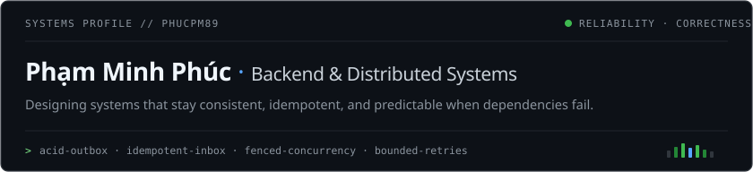
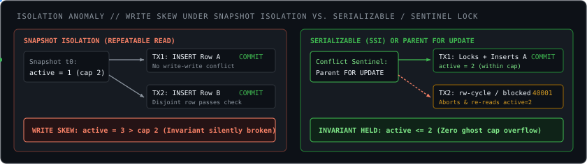
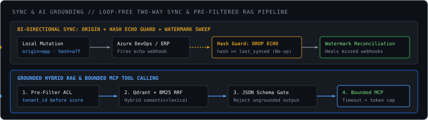

  <picture>
    <source media="(prefers-color-scheme: dark)" srcset="./assets/hero-dark.svg" />
    <source media="(prefers-color-scheme: light)" srcset="./assets/hero-light.svg" />
    
  </picture>

  

---

### Engineering Thesis

Making a system work when every service is fast and healthy is the easy part. The hard part is handling **chain-reaction failures**: polling relays skipping uncommitted rows, snapshot isolation allowing write skew, retry storms turning a short slowdown into a full outage, and GC pauses breaking cache-only locks.

I design backend systems around **data invariants and failure boundaries**—assuming network timeouts, duplicate events, clock drift, and slow dependencies will happen in production.

  <picture>
    <source media="(prefers-color-scheme: dark)" srcset="./assets/architecture-dark.svg" />
    <source media="(prefers-color-scheme: light)" srcset="./assets/architecture-light.svg" />
    
  </picture>

---

### Systems Architecture Deep-Dives

#### 1. Storage Internals, Isolation & Write Boundaries

  <picture>
    <source media="(prefers-color-scheme: dark)" srcset="./assets/deepdive-1-isolation-dark.svg" />
    <source media="(prefers-color-scheme: light)" srcset="./assets/deepdive-1-isolation-light.svg" />
    
  </picture>

* **Do not trust default isolation blindly:** `Read Committed` allows lost updates and non-repeatable reads. Even `Snapshot Isolation` (`Repeatable Read` in PostgreSQL) still allows **Write Skew**: two transactions read the same snapshot, pass validation, insert two separate rows, and break a shared limit (like max active sessions). For cross-row rules, use `SERIALIZABLE` (SSI) or lock a shared parent row (`SELECT ... FOR UPDATE`) so requests check the limit one by one.
* **Keep high-churn Outbox/Inbox tables clean:** Frequent `DELETE`s leave dead rows behind (MVCC bloat) and slow down indexes, while an idle open transaction pins PostgreSQL's cleanup horizon (`xmin`) and blocks vacuuming. Partition append-only event tables by time and drop old partitions (`DROP TABLE`), paired with `idle_in_transaction_session_timeout`.
* **Match locking to contention:** Use **Optimistic Concurrency** (`rowversion` / `xmin` + jittered retry) when conflicts are rare. Use **atomic conditional updates** (`WHERE available >= @qty`) or **`FOR UPDATE SKIP LOCKED`** for busy job queues. Use **keyset pagination** `(ts, id)` instead of `OFFSET` so deep pages stay fast and do not skip rows.

---

#### 2. Distributed Messaging, CDC & Causal Ordering

  <picture>
    <source media="(prefers-color-scheme: dark)" srcset="./assets/deepdive-2-outbox-gap-dark.svg" />
    <source media="(prefers-color-scheme: light)" srcset="./assets/deepdive-2-outbox-gap-light.svg" />
    
  </picture>

* **Avoid the Outbox polling gap:** If `TX1` gets `id=10` (slow) and `TX2` gets `id=11` and commits first, a simple poller (`WHERE id > last_id`) only sees `11`, moves its cursor to `11`, and permanently skips `10`. Fix this with **WAL-ordered CDC** (`Debezium` via `pgoutput`, which streams in real commit order) or status-indexed `SKIP LOCKED` claims.
* **Make retries and deliveries safe:** Brokers guarantee *at-least-once* delivery, not *exactly-once* side effects. Dedup events in a consumer **Inbox table** (`UNIQUE(message_id)` inside the local DB transaction). For API `Idempotency-Key` records, store `(key, payload_hash, state, response)`: return the saved response on exact retry, `409 Conflict` if the first request is still running, and `422` if the same key is reused with a different payload.
* **Keep Kafka consumers stable:** Partition by aggregate ID (`entity_id`) to keep per-entity order. Avoid slow blocking I/O inside the poll loop or limit batch sizes under `max.poll.interval.ms` with cooperative sticky assignment so rebalances do not trigger duplicate storms.
* **Design Sagas around a pivot step:** Model long workflows as persisted state machines. Steps before the **pivot transaction** (point of no return) need clean undo/compensation actions; steps after it must retry forward safely with deadline timers for stuck jobs.

---

#### 3. Tail Latency, Metastatic Failure & Runtime Hygiene

  <picture>
    <source media="(prefers-color-scheme: dark)" srcset="./assets/deepdive-3-retry-fencing-dark.svg" />
    <source media="(prefers-color-scheme: light)" srcset="./assets/deepdive-3-retry-fencing-light.svg" />
    
  </picture>

* **Stop retry storms before they keep the system down:** Blind retries across 3 service hops multiply load (`3 × 3 × 3 = 27×`) and keep a slowed service crashed even after user traffic drops. Pass the **remaining request deadline** downstream (`CancellationToken` / `context.Context`), cap retries with a **retry budget (≤ 10% of traffic)** plus full jitter, and fail fast (`503`) when queues fill up.
* **Never trust cache locks without DB fencing:** A Redis lock can expire while a worker freezes during a GC pause; when the worker wakes up, it can overwrite newer data. Pair distributed leases with a **monotonic fencing token** checked directly by the database (`WHERE last_fence_token < @token`).
* **Watch clock drift & `.NET / Go` runtime limits:** Never use wall-clock timestamps (`DateTime.UtcNow`) for timeouts or event order across servers—use monotonic clocks for elapsed time and DB/LSN order for causality. Guard against `TIME_WAIT` port exhaustion, `HTTP/2` stream limits on single gRPC channels, thread-pool starvation (sync-over-async), and large-object GC spikes.

---

#### 4. Zero-Trust Auth, Session Lineage & Multi-Tenant Isolation

  <picture>
    <source media="(prefers-color-scheme: dark)" srcset="./assets/deepdive-4-auth-lineage-dark.svg" />
    <source media="(prefers-color-scheme: light)" srcset="./assets/deepdive-4-auth-lineage-light.svg" />
    
  </picture>

* **Handle parallel tabs without breaking reuse protection:** Rotating refresh tokens stop replay attacks, but two browser tabs refreshing at the same instant look like token theft. Track tokens by **family lineage** `(family_id, jti, parent_jti)`: allow a short client mutex + server grace window (`predecessor_jti`) so parallel tabs share the new token smoothly, but revoke the entire token family immediately on real replay after the window.
* **Risk-based step-up MFA & Claims:** Combine `Role Claims + User Claims` for fine-grained permissions, and score browser/environment changes to trigger **TOTP / SMS OTP** step-up checks instead of silently trusting drifted sessions or locking out real users.
* **Enforce multi-tenancy inside the database:** Application `WHERE tenant_id = @id` filters can be missed in a single query. Add **PostgreSQL Row-Level Security (RLS)** via `SET LOCAL app.tenant_id` so the database itself blocks cross-tenant reads or writes, backed by per-tenant rate limits.

---

#### 5. External Sync State Machines & Grounded AI Systems

  <picture>
    <source media="(prefers-color-scheme: dark)" srcset="./assets/deepdive-5-sync-rag-dark.svg" />
    <source media="(prefers-color-scheme: light)" srcset="./assets/deepdive-5-sync-rag-light.svg" />
    
  </picture>

* **Keep two-way sync loop-free:** Stop webhook echo loops by tagging outbound changes with origin metadata + payload hashes, and ignoring incoming webhooks that match our own recent hash. Treat webhooks as fast hints backed by scheduled **watermark sweeps** (`last_sync - clock_skew_window`) and clear per-field ownership to prevent silent overwrites.
* **Build grounded RAG & safe tool calling:** Always filter by `tenant_id` and user ACLs **before** vector scoring (`Qdrant` + `BM25` + `RRF`), never after picking top-K. Validate every LLM response against strict JSON Schemas, and wrap `MCP` / tool calls with timeouts, step limits, circuit breakers, and per-tenant token budgets.

---

### Failure Mode Playbook

| Failure Scenario | What Breaks Silently | How I Prevent It |
| :--- | :--- | :--- |
| Outbox poller hits an uncommitted ID gap (`id=11` commits before `10`) | Poller moves cursor to `11`; event `10` is lost forever | **WAL-ordered CDC (`Debezium`)** or status-indexed `SKIP LOCKED` |
| Two transactions check the same limit and insert different rows | **Write Skew** breaks the shared limit under Snapshot Isolation | `SERIALIZABLE` (SSI) or parent-row `SELECT ... FOR UPDATE` |
| Worker freezes during GC past Redis lock TTL | Stale worker wakes up and overwrites newer state | **Monotonic fencing token** checked inside the DB `UPDATE` |
| Multi-hop retries fire during a downstream slowdown | `N^k` retry storm keeps the system crashed after load drops | **Deadline propagation**, ≤10% retry budget + jitter, fast-fail `503` |
| Two browser tabs refresh a rotating JWT together | Server flags false token reuse and logs out a real user | Cross-tab refresh lock + `(family_id, predecessor_jti)` grace cache |
| Continuous `DELETE` on busy Outbox / Inbox tables | Dead-tuple bloat & `xmin` pinning slow down queries | Time-partitioned tables (`DROP PARTITION`) + idle tx timeout |

---

### Decision Heuristics (Trade-offs)

* **Modular Monolith vs. Microservices:** Keep clean module and schema boundaries inside one deployable while domain rules change fast; split into separate services only when scaling, fault isolation, or team ownership truly require network boundaries.
* **Debezium CDC vs. Polling Outbox:** Use `SKIP LOCKED` polling for simpler ops at low/medium write load; switch to WAL-based CDC when polling I/O, sub-second lag, or strict commit-order delivery matters.
* **Synchronous gRPC/Protobuf vs. Async Kafka/RabbitMQ:** Use `gRPC` when the caller needs an immediate yes/no answer; send cross-service side effects, notifications, and third-party sync through durable queues.
* **Optimistic vs. Pessimistic Locking:** Optimistic locking (`xmin`/`rowversion`) is faster when conflicts are rare; move to row locks or partitioned queues once retry collisions hurt tail latency.

---

### Technical Stack

| Layer | Technologies & Mechanisms |
| :--- | :--- |
| **Languages & Runtimes** | `C# / .NET` · `Go` · `Java` · `TypeScript` |
| **Storage & Indexing** | `PostgreSQL` (MVCC, SSI, RLS, Partitioning) · `SQL Server` · `Redis` · `MongoDB` · `Qdrant` |
| **Messaging & Transport** | `Apache Kafka` · `RabbitMQ` · `MassTransit` · `Debezium CDC` · `gRPC` · `Protocol Buffers` |
| **Reliability & Security** | `CQRS` · `Saga` · `Outbox/Inbox` · `Idempotency` · `Fencing Tokens` · `DLQ` · `Circuit Breaker` · `MFA (TOTP/SMS)` |
| **AI & Delivery** | `LLM Integration` · `Hybrid RAG` · `MCP` · `Tool Calling` · `Docker` · `GitLab CI/CD` · `GitHub Actions` |

---

  <b>Contact:</b> <a href="mailto:minhphuc2308031@gmail.com">minhphuc2308031@gmail.com</a> ·
  <b>GitHub:</b> <a href="https://github.com/PhucPM89">github.com/PhucPM89</a>

  <i>Correctness is defined by invariants under failure, not throughput under ideal conditions.</i>

