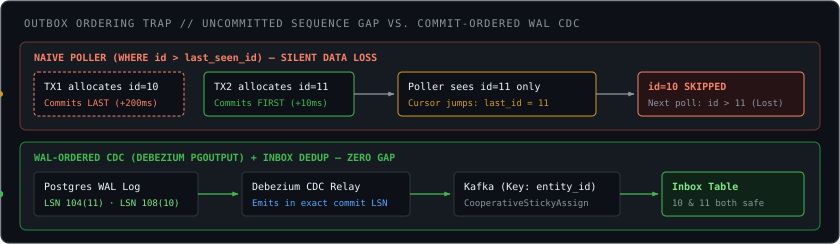
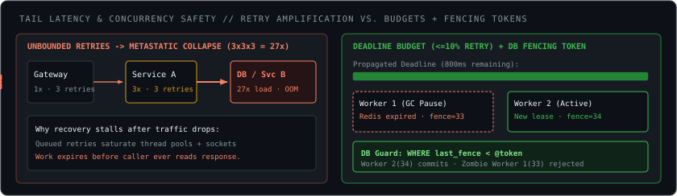

  <picture>
    <source media="(prefers-color-scheme: dark)" srcset="./assets/hero-dark.svg" />
    <source media="(prefers-color-scheme: light)" srcset="./assets/hero-light.svg" />
    
  </picture>

  

---

### Engineering Thesis

Happy-path throughput is cheap. The real cost of a distributed system lives in **second-order failures**: uncommitted sequence gaps in polling relays, write skew under snapshot isolation, retry storms turning brief brownouts into metastatic outages, and GC pauses invalidating cache-only locks.

I design backend systems from **storage invariants and failure boundaries outward**—treating network partitions, clock skew, duplicate deliveries, and partial degradation as normal operating states.

  <picture>
    <source media="(prefers-color-scheme: dark)" srcset="./assets/architecture-dark.svg" />
    <source media="(prefers-color-scheme: light)" srcset="./assets/architecture-light.svg" />
    
  </picture>

---

### Systems Architecture Deep-Dives

#### 1. Storage Internals, Isolation & Write Boundaries

  <picture>
    <source media="(prefers-color-scheme: dark)" srcset="./assets/deepdive-1-isolation-dark.svg" />
    <source media="(prefers-color-scheme: light)" srcset="./assets/deepdive-1-isolation-light.svg" />
    
  </picture>

* **Beyond ORM isolation defaults:** `Read Committed` allows non-repeatable reads and lost updates; `Snapshot Isolation` (`Repeatable Read` in PostgreSQL) still permits **Write Skew** when concurrent transactions validate disjoint rows against a shared invariant. For cross-row invariants (e.g., max active sessions, quota caps), enforce `SERIALIZABLE` (SSI) or materialize a conflict sentinel (`SELECT ... FOR UPDATE` on a parent aggregate).
* **MVCC bloat & Outbox lifecycle:** High-churn `Outbox` / `Inbox` tables suffer dead-tuple bloat and index amplification (defeating PostgreSQL HOT updates) if pruned via continuous `DELETE`, while long `IDLE IN TRANSACTION` sessions pin `xmin` horizons. Partition append-only event tables by time and drop expired partitions atomically (`DROP TABLE`) alongside `idle_in_transaction_session_timeout`.
* **Contention-matched concurrency:** Avoid global locks. Use **Optimistic Concurrency** (`rowversion` / `xmin` + jittered retry) when conflict probability is low; use **atomic conditional updates** (`WHERE available >= @qty`) or **`FOR UPDATE SKIP LOCKED`** for hot queues; use **keyset pagination** `(ts, id)` instead of `OFFSET` to prevent `O(N)` scans and row drift under concurrent writes.

---

#### 2. Distributed Messaging, CDC & Causal Ordering

  <picture>
    <source media="(prefers-color-scheme: dark)" srcset="./assets/deepdive-2-outbox-gap-dark.svg" />
    <source media="(prefers-color-scheme: light)" srcset="./assets/deepdive-2-outbox-gap-light.svg" />
    
  </picture>

* **The Outbox polling trap (Uncommitted Sequence Gaps):** Polling an `Outbox` table by monotonic `IDENTITY` / `created_at` cursor silently drops events when `TX1` allocates `id=10`, `TX2` allocates `id=11` and commits first, and the poller advances its watermark past `10`. Solve this via **LSN/WAL-ordered CDC** (`Debezium` over `pgoutput`, which emits strictly in commit order) or status-indexed `SKIP LOCKED` claims.
* **Effectively-once semantics & Idempotency contracts:** Brokers guarantee at-least-once delivery, not exactly-once effects. Pair consumer-side **Inbox deduplication** (`UNIQUE(message_id)` inside the local ACID write) with HTTP/RPC idempotency records storing `(key, payload_hash, state, response_snapshot)`: replay cached response on identical retry, `409 Conflict` while in-flight, and `422` on key reuse with a mismatched payload hash.
* **Kafka rebalance stability & ordering:** Partition by aggregate key (`entity_id`) for per-entity causal ordering. Decouple slow downstream I/O from the poll loop or bound batch sizes under `max.poll.interval.ms` with cooperative sticky assignment to prevent rebalance storms.
* **Saga boundaries & Pivot Transactions:** Model multi-service workflows as persistent state machines. Separate reversible steps (with idempotent semantic compensations), the **pivot transaction** (point of no return), and retriable post-pivot steps—backed by deadline timers for stuck states.

---

#### 3. Tail Latency, Metastatic Failure & Runtime Hygiene

  <picture>
    <source media="(prefers-color-scheme: dark)" srcset="./assets/deepdive-3-retry-fencing-dark.svg" />
    <source media="(prefers-color-scheme: light)" srcset="./assets/deepdive-3-retry-fencing-light.svg" />
    
  </picture>

* **Preventing retry amplification:** Unbounded retries across a 3-hop call graph (`3 × 3 × 3 = 27×` traffic) turn transient brownouts into **metastatic failures** that persist after load normalizes. Enforce **end-to-end deadline propagation** (`CancellationToken` / `context.Context` remaining budget, not fixed per-hop timeouts), **retry budgets** (cap retries ≤10% of active requests) with full jitter, and **adaptive load shedding** (`503` fast-fail before queue depth destroys P99).
* **Why cache locks fail without storage fencing:** A Redis lease (`SET NX PX` / Redlock) can expire during a stop-the-world GC pause or CPU stall while the paused worker still holds an in-flight DB write. Pair distributed leases with monotonically increasing **fencing tokens** verified at the DB write boundary (`WHERE last_fence_token < @token`).
* **Clock skew & runtime bottlenecks:** Never order distributed events or validate lease lifetimes using wall-clock time (NTP step jumps); use monotonic clocks for elapsed durations and DB/LSN sequences for causal order. Watch `.NET` / `Go` runtime limits: `TIME_WAIT` port exhaustion, `HTTP/2` `MAX_CONCURRENT_STREAMS` saturation on single gRPC channels, thread-pool starvation, and Gen2/LOH allocation spikes.

---

#### 4. Zero-Trust Auth, Session Lineage & Multi-Tenant Isolation

  <picture>
    <source media="(prefers-color-scheme: dark)" srcset="./assets/deepdive-4-auth-lineage-dark.svg" />
    <source media="(prefers-color-scheme: light)" srcset="./assets/deepdive-4-auth-lineage-light.svg" />
    
  </picture>

* **Token family tracking & cross-tab races:** Rotating refresh tokens protect against replay, yet parallel browser tabs racing to refresh trigger false reuse revocation. Store token lineage `(family_id, jti, parent_jti)` so true stolen-token reuse revokes the entire family immediately, while legitimate multi-tab races resolve cleanly via client-side refresh mutex + a short server-side grace cache keyed by `predecessor_jti`.
* **Risk-adaptive step-up MFA & Layered RBAC/ABAC:** Combine `Role Claims + User Claims` with environment/fingerprint drift scoring to trigger targeted **TOTP / SMS OTP** step-up verification instead of silent session trust or brittle lockouts.
* **Tenant isolation in depth:** Do not rely solely on `WHERE tenant_id = @id` in application code—enforce **PostgreSQL Row-Level Security (RLS)** bound to transaction-local session context (`SET LOCAL app.tenant_id`), paired with per-tenant rate/quota isolation against noisy neighbors.

---

#### 5. External Sync State Machines & Grounded AI Systems

  <picture>
    <source media="(prefers-color-scheme: dark)" srcset="./assets/deepdive-5-sync-rag-dark.svg" />
    <source media="(prefers-color-scheme: light)" srcset="./assets/deepdive-5-sync-rag-light.svg" />
    
  </picture>

* **Loop-free bi-directional sync:** Prevent webhook echo loops via origin correlation metadata + normalized payload hashes. Treat webhooks as low-latency hints backed by watermarked reconciliation sweeps (`last_sync - clock_skew_window`) and explicit field-level ownership to avoid split-brain overwrites.
* **Grounded RAG & bounded agentic pipelines:** Enforce tenant/ACL metadata filtering *before* vector scoring (`Qdrant` + `BM25` + `RRF` fusion—never post-filter top-K). Validate all LLM outputs against strict JSON Schemas at runtime, isolate `MCP` / tool execution behind per-call timeouts, recursion caps, circuit breakers, and per-tenant token/cost budgets.

---

### Failure Mode Playbook

| Failure Scenario | Second-Order Risk | Architectural Defense |
| :--- | :--- | :--- |
| Polling Outbox hits uncommitted sequence gap (`TX1` commits after `TX2`) | Poller advances watermark past `id=10`; event is permanently lost | **WAL-ordered CDC (`Debezium`)** or status-indexed `FOR UPDATE SKIP LOCKED` |
| Concurrent tx validate disjoint rows under Snapshot Isolation | **Write Skew** violates cross-row invariant (duplicate active quota/session) | `SERIALIZABLE` (SSI) or lock materialized conflict sentinel (`FOR UPDATE`) |
| Worker stalls past Redis lease TTL during GC pause | Split-brain write corrupts aggregate state after lock expires | **Monotonic fencing token** asserted atomically on DB write |
| Multi-hop retries fire blindly during downstream brownout | `N^k` retry storm triggers self-inflicted **metastatic outage** | End-to-end **deadline propagation**, ≤10% retry budget + full jitter, load shedding |
| Rotating refresh token raced by two browser tabs | False reuse alarm revokes valid authenticated banking session | Cross-tab refresh lock + `(family_id, predecessor_jti)` short grace cache |
| Continuous `DELETE` on high-throughput Outbox / Inbox tables | Dead-tuple bloat, autovacuum lag, `xmin` pinning degrades P99 | Time-partitioned tables (`DROP PARTITION`) + `idle_in_transaction` timeout |

---

### Decision Heuristics (Trade-offs)

* **Modular Monolith vs. Microservices:** Keep strict module boundaries and separate schemas inside one deployable until scaling profiles, fault-isolation blast radius, or team ownership demand network boundaries—network calls are not free modularity.
* **Debezium CDC vs. Polling Outbox:** Use `SKIP LOCKED` polling for operational simplicity at low/moderate write rates; adopt WAL-based CDC when polling IOPS, sub-second relay latency, or strict commit-order emission matters.
* **Synchronous gRPC/Protobuf vs. Async Kafka/RabbitMQ:** Keep `gRPC` on paths requiring immediate invariant admission; offload cross-aggregate side effects, fan-out notifications, and third-party sync onto durable broker topologies.
* **Optimistic vs. Pessimistic Locking:** Optimistic (`xmin`/`rowversion`) wins under low contention; switch to serialized partitioned queues or explicit row locks before retry thrashing degrades tail latency.

---

### Technical Stack

| Layer | Technologies & Mechanisms |
| :--- | :--- |
| **Languages & Runtimes** | `C# / .NET` · `Go` · `Java` · `TypeScript` |
| **Storage & Indexing** | `PostgreSQL` (MVCC, SSI, RLS, Partitioning) · `SQL Server` · `Redis` · `MongoDB` · `Qdrant` |
| **Messaging & Transport** | `Apache Kafka` · `RabbitMQ` · `MassTransit` · `Debezium CDC` · `gRPC` · `Protocol Buffers` |
| **Reliability & Security** | `CQRS` · `Saga` · `Outbox/Inbox` · `Idempotency` · `Fencing Tokens` · `DLQ` · `Circuit Breaker` · `MFA (TOTP/SMS)` |
| **AI & Delivery** | `LLM Integration` · `Hybrid RAG` · `MCP` · `Tool Calling` · `Docker` · `GitLab CI/CD` · `GitHub Actions` |

---

  <b>Contact:</b> <a href="mailto:minhphuc2308031@gmail.com">minhphuc2308031@gmail.com</a> ·
  <b>GitHub:</b> <a href="https://github.com/PhucPM89">github.com/PhucPM89</a>

  <i>Correctness is defined by invariants under failure, not throughput under ideal conditions.</i>

