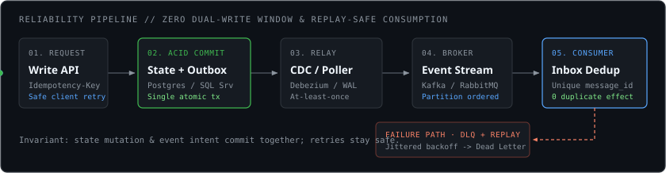
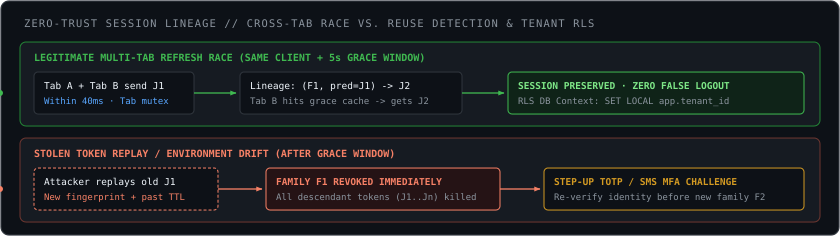

  <picture>
    <source media="(prefers-color-scheme: dark)" srcset="./assets/hero-dark.svg" />
    <source media="(prefers-color-scheme: light)" srcset="./assets/hero-light.svg" />
    
  </picture>

  

---

### Focus

Getting code to work when every database, broker, and API responds in 10ms is the easy part. Most real production bugs happen in the second-order failures: polling relays skipping uncommitted rows, snapshot isolation allowing write skew, retry storms keeping a degraded service down, and GC pauses breaking cache-only locks.

I build backend systems around data invariants and explicit failure boundaries, assuming timeouts, duplicate deliveries, clock drift, and partial outages are normal operating states.

  <picture>
    <source media="(prefers-color-scheme: dark)" srcset="./assets/architecture-dark.svg" />
    <source media="(prefers-color-scheme: light)" srcset="./assets/architecture-light.svg" />
    
  </picture>

---

### Systems Architecture Deep-Dives

#### 1. Storage Internals, Isolation & Write Boundaries

  <picture>
    <source media="(prefers-color-scheme: dark)" srcset="./assets/deepdive-1-isolation-dark.svg" />
    <source media="(prefers-color-scheme: light)" srcset="./assets/deepdive-1-isolation-light.svg" />
    
  </picture>

Default isolation levels hide subtle concurrency bugs. Read Committed allows lost updates and non-repeatable reads, while Snapshot Isolation (Repeatable Read in PostgreSQL) still permits **write skew**: two transactions read the same snapshot, pass validation, insert two separate rows, and break a shared limit like max active sessions. For cross-row invariants, I use Serializable (SSI) or lock a shared parent row with `FOR UPDATE` so concurrent requests check the rule sequentially.

High-churn Outbox and Inbox tables also degrade fast if pruned with continuous deletes, which create MVCC dead-tuple bloat and index churn. An idle open transaction pins PostgreSQL's cleanup horizon and blocks autovacuum altogether, so I prefer time-partitioned event tables dropped atomically by partition alongside an idle-transaction timeout. For general concurrency and reads, I pick the primitive per workload: optimistic version checks where conflicts are rare, atomic conditional updates or `SKIP LOCKED` for hot queues, and keyset pagination instead of offset scans.

---

#### 2. Distributed Messaging, CDC & Causal Ordering

  <picture>
    <source media="(prefers-color-scheme: dark)" srcset="./assets/deepdive-2-outbox-gap-dark.svg" />
    <source media="(prefers-color-scheme: light)" srcset="./assets/deepdive-2-outbox-gap-light.svg" />
    
  </picture>

Polling an Outbox table by an auto-incrementing ID or timestamp has a classic gap bug: if transaction A claims ID 10 slowly while transaction B claims ID 11 and commits first, a naive poller advances its cursor past 10 and loses that event permanently. Streaming directly from the write-ahead log via Debezium CDC emits events in actual commit order, or if polling is required, claims must use status-indexed `SKIP LOCKED` rows rather than a monotonic cursor.

Because brokers guarantee at-least-once delivery rather than exactly-once side effects, consumers enforce deduplication in a local Inbox table inside the same database transaction as the state update. On write APIs, idempotency records store the request payload hash alongside the key: exact retries return the cached response, in-flight duplicates get a 409 Conflict, and reusing a key with a modified payload fails with 422. For Kafka consumers, keying partitions by entity ID preserves per-aggregate order while cooperative sticky assignment and bounded poll batches prevent rebalance storms. Long-lived Sagas follow explicit state machines split around a pivot transaction: steps before it define semantic compensations, and steps after it retry forward.

---

#### 3. Tail Latency, Metastatic Failure & Runtime Hygiene

  <picture>
    <source media="(prefers-color-scheme: dark)" srcset="./assets/deepdive-3-retry-fencing-dark.svg" />
    <source media="(prefers-color-scheme: light)" srcset="./assets/deepdive-3-retry-fencing-light.svg" />
    
  </picture>

Blind retries across multiple service hops turn minor slowdowns into metastatic outages: three retries across three layers multiply load by 27x and keep downstream databases pinned even after user traffic drops. To prevent self-inflicted collapse, outbound calls propagate the remaining request deadline downstream, cap retries under a strict retry budget (around 10% of active traffic) with full jitter, and shed excess load early with 503s before queues saturate.

Distributed locks in Redis are never sufficient on their own for correctness, because a worker paused by GC can wake up after its lease expires and overwrite newer writes. Any lease used for mutual exclusion needs a monotonic fencing token verified atomically at the database write boundary. I also avoid wall-clock timestamps for timeouts or distributed ordering due to NTP drift, and watch runtime bottlenecks closely in .NET and Go: socket exhaustion, HTTP/2 stream limits on shared gRPC channels, thread-pool starvation from sync-over-async calls, and large-object GC pauses.

---

#### 4. Zero-Trust Auth, Session Lineage & Multi-Tenant Isolation

  <picture>
    <source media="(prefers-color-scheme: dark)" srcset="./assets/deepdive-4-auth-lineage-dark.svg" />
    <source media="(prefers-color-scheme: light)" srcset="./assets/deepdive-4-auth-lineage-light.svg" />
    
  </picture>

Rotating refresh tokens catch stolen-token replays, but parallel browser tabs refreshing at the same moment look identical to token theft if handled naively. Tracking refresh tokens by family lineage lets the server revoke an entire session tree on real replay while resolving legitimate tab races via a client refresh mutex and a short grace window mapped to the previous token ID.

For access control, combining Role Claims and User Claims gives both coarse role boundaries and user-specific overrides, while environment and fingerprint drift signals drive step-up TOTP or SMS OTP checks rather than locking out users on minor browser changes. In multi-tenant databases, relying solely on application-level tenant filters is fragile because one missed query leaks data; pairing them with PostgreSQL Row-Level Security bound to the transaction context keeps isolation enforced inside the engine itself.

---

#### 5. External Sync State Machines & Grounded AI Systems

  <picture>
    <source media="(prefers-color-scheme: dark)" srcset="./assets/deepdive-5-sync-rag-dark.svg" />
    <source media="(prefers-color-scheme: light)" srcset="./assets/deepdive-5-sync-rag-light.svg" />
    
  </picture>

Two-way integrations with platforms like Azure DevOps or ERPs break easily through webhook echo loops and dropped deliveries. Tagging outbound writes with origin metadata and normalized payload hashes lets the receiver drop echoed updates immediately, while periodic watermark reconciliation sweeps heal missed webhooks and explicit field ownership prevents silent overwrites.

When integrating LLMs and RAG into production workflows, tenant and ACL filters must run before vector scoring rather than after picking top-K results. Combining Qdrant dense search with BM25 lexical matching improves exact-identifier recall, strict JSON schema validation keeps model outputs safe for downstream code, and MCP tool calls stay bounded behind timeouts, step caps, and per-tenant token budgets.

---

### Failure Mode Playbook

| Failure Scenario | What Breaks Silently | How I Prevent It |
| :--- | :--- | :--- |
| Outbox poller hits an uncommitted ID gap | Cursor jumps past the slower transaction; event is lost | WAL-ordered CDC (Debezium) or status-indexed `SKIP LOCKED` |
| Two transactions check a shared limit concurrently | Write skew under Snapshot Isolation violates the cap | Serializable (SSI) or parent-row `FOR UPDATE` sentinel |
| Worker stalls in GC past Redis lock TTL | Stale worker wakes up and overwrites newer state | Monotonic fencing token checked inside the DB update |
| Multi-hop retries fire during a brownout | Amplified retry storm keeps the system down | Deadline propagation, ~10% retry budget, jitter, load shedding |
| Two browser tabs rotate the same refresh token | False reuse detection logs out a valid user | Cross-tab refresh mutex and short predecessor grace cache |
| Continuous deletes on busy Outbox / Inbox tables | MVCC dead-tuple bloat and vacuum lag degrade P99 | Time-partitioned tables (drop partition) + idle tx timeout |

---

### Decision Heuristics

* **Modular Monolith vs. Microservices:** Keep strict module and schema boundaries inside one deployable while domain rules change fast; split services only when scaling, fault isolation, or team ownership justify network boundaries.
* **Debezium CDC vs. Polling Outbox:** Use `SKIP LOCKED` polling for simpler operations at moderate write volume; adopt WAL-based CDC when polling load, sub-second lag, or strict commit order matters.
* **Synchronous gRPC vs. Async Kafka/RabbitMQ:** Keep gRPC on paths that need an immediate invariant check; push cross-service side effects, notifications, and external sync onto durable queues.
* **Optimistic vs. Pessimistic Locking:** Optimistic version checks win when conflicts are rare; move to row locks or partitioned queues once retry collisions hurt tail latency.

---

### Technical Stack

| Layer | Technologies & Mechanisms |
| :--- | :--- |
| **Backend & Runtimes** | C# · .NET · Go · Java · TypeScript |
| **Storage & Vector** | PostgreSQL · SQL Server · Redis · MongoDB · Qdrant |
| **Messaging & RPC** | Kafka · RabbitMQ · MassTransit · Debezium CDC · gRPC · Protobuf |
| **Reliability & Security** | CQRS · Saga · Outbox/Inbox · Idempotency · Fencing Tokens · DLQ · Circuit Breaker · MFA |
| **AI & Delivery** | LLM Integration · Hybrid RAG · MCP · Tool Calling · Docker · GitLab CI/CD · GitHub Actions |

---

  <b>Contact:</b> <a href="mailto:minhphuc2308031@gmail.com">minhphuc2308031@gmail.com</a> ·
  <b>GitHub:</b> <a href="https://github.com/PhucPM89">github.com/PhucPM89</a>

  <i>Correctness is defined by invariants under failure, not throughput under ideal conditions.</i>

